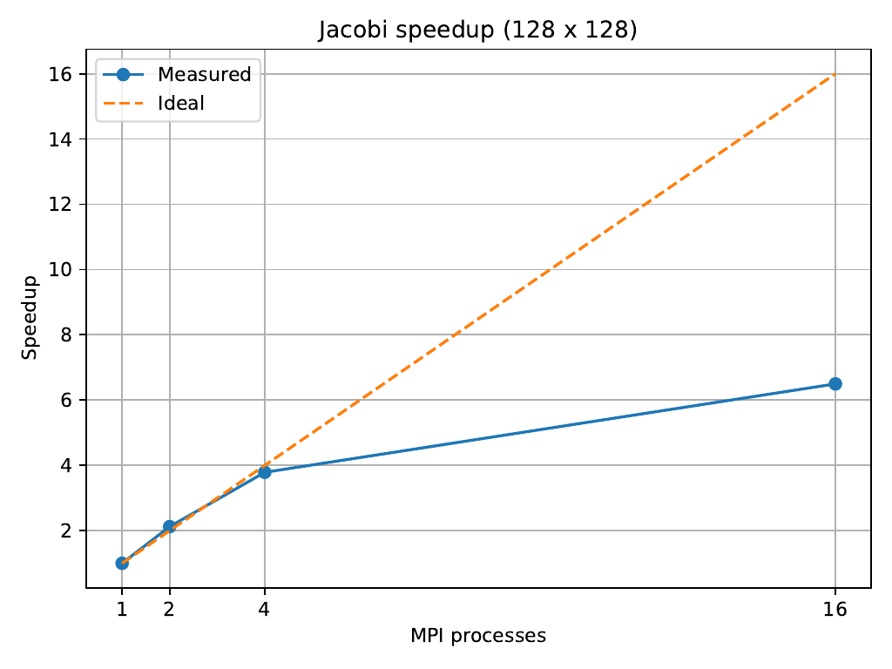
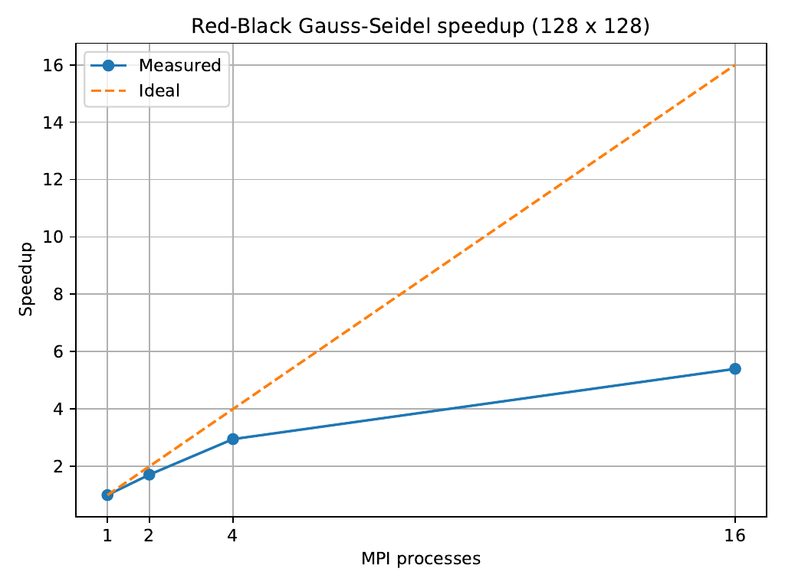

# AMS 530: Project 3, Problem 3.4
## Jacobi and Gauss-Seidel: Numerical Results and MPI Performance

**Matthew DiCicco**

## 1. Problem definition and numerical methods

This project examines iterative methods for a finite-difference discretization of a two-dimensional elliptic partial differential equation of Laplace/Poisson type. The resulting linear system uses the standard five-point stencil:

`4u(i,j) - u(i-1,j) - u(i+1,j) - u(i,j-1) - u(i,j+1) = b(i,j)`

The assignment specifies a zero initial approximation. Boundary values enter through the problem definition; in the submitted implementations, values outside the grid of interior unknowns are initialized to zero. This is a description of the implementation, not a claim that the assignment separately imposed zero boundary values.

The original problem has a 4 × 4 grid of interior unknowns, giving a system of 16 equations. The larger computation uses a 128 × 128 grid with 16,384 interior unknowns. To preserve the pattern of the right-hand side, each value in the original 4 × 4 arrangement is expanded into a 32 × 32 block. Consequently, an original entry of 1 produces a block of ones, and an entry of 0 produces a block of zeros.

Jacobi computes each new approximation using values from the preceding iteration. Standard Gauss-Seidel updates values in place, allowing later calculations in the same sweep to use newly updated values. Red-black Gauss-Seidel separates the grid into two checkerboard colors and updates each color in turn, allowing points of the same color to be computed independently.

Convergence is evaluated using the Euclidean norm of the residual, `||Au - b||₂`. A smaller residual indicates that the approximation satisfies the discrete system more closely. It does not, by itself, measure error relative to the exact solution of the underlying PDE.

## 2. Initial 4 × 4 computation

Using one processor, the `serial_small.c` program constructs the 16 × 16 coefficient matrix explicitly, with diagonal entries of 4 and entries of -1 for adjacent grid points. The right-hand side has four rows of `[1, 1, 0, 0]`. Jacobi and standard Gauss-Seidel are each run for 10 iterations.

| Iteration | Jacobi residual | Gauss-Seidel residual |
|---:|---:|---:|
| 1 | 1.870829 | 1.644339 |
| 2 | 1.375000 | 1.007284 |
| 3 | 1.056509 | 0.637006 |
| 4 | 0.832425 | 0.410528 |
| 5 | 0.664668 | 0.266619 |
| 6 | 0.534305 | 0.173883 |
| 7 | 0.430933 | 0.113622 |
| 8 | 0.348118 | 0.074310 |
| 9 | 0.281435 | 0.048619 |
| 10 | 0.227608 | 0.031816 |

Both methods reduce the residual at every iteration. After 10 iterations, Gauss-Seidel has a residual of 0.031816, compared with 0.227608 for Jacobi. Thus, for this problem and the same number of iterations, standard Gauss-Seidel reduces the residual more rapidly.

## 3. Expanded 128 × 128 computation

Using one processor, the `serial_large.c` program applies Jacobi, standard Gauss-Seidel, and red-black Gauss-Seidel to the 128 × 128 system. Each method performs 1,000 iterations. The measured runtimes and final residuals are shown below.

| Method | Total time (s) | Average time per iteration (s) | Final residual |
|---|---:|---:|---:|
| Jacobi | 0.080000 | 0.000080 | 46.564793 |
| Standard Gauss-Seidel | 0.110000 | 0.000110 | 31.256913 |
| Red-black Gauss-Seidel | 0.050000 | 0.000050 | 44.211550 |

Standard Gauss-Seidel produces the smallest residual after 1,000 iterations, although it also has the longest measured runtime. Red-black Gauss-Seidel has the shortest measured runtime, while Jacobi falls between the two methods. These results distinguish the computational cost of an iteration from the amount by which that iteration reduces the residual.

The individual iteration times printed by this program are often zero because the `clock()` measurements have limited resolution at this timescale. The total runtimes provide a more useful comparison. Residual magnitudes from the 4 × 4 and 128 × 128 systems should not be compared directly because the systems contain different numbers of unknowns.

## 4. MPI implementation and benchmark procedure

The MPI implementation divides the 128 grid rows among the participating processes. Each process stores its assigned rows and neighboring halo rows. Jacobi exchanges halo information before updating its local grid points. Red-black Gauss-Seidel exchanges the necessary boundary information between its two color updates. These exchanges use `MPI_Sendrecv`.

The `parallel_large.c` program performs 1,000 iterations for each method at 1, 2, 4, and 16 MPI processes. Solver time is measured with `MPI_Wtime()`, and the reported runtime is the maximum elapsed time across processes. The final residual is computed after the timed solver section. The measurements were obtained on Stony Brook University's SeaWulf cluster using an interactive compute-node allocation. The benchmark script launches the processes with `srun --mpi=pmi2`.

## 5. MPI performance results

| MPI processes | Jacobi time (s) | Jacobi speedup | Red-black time (s) | Red-black speedup |
|---:|---:|---:|---:|---:|
| 1 | 0.063757060 | 1.00 | 0.079983359 | 1.00 |
| 2 | 0.030034152 | 2.12 | 0.046720777 | 1.71 |
| 4 | 0.016832030 | 3.79 | 0.027102584 | 2.95 |
| 16 | 0.009814292 | 6.50 | 0.014808961 | 5.40 |

Speedup is calculated from the MPI measurements as `S(p) = T(1) / T(p)`, where `p` is the number of processes. Ideal linear speedup would equal `p`. Both methods become faster as the number of processes increases, but neither achieves ideal scaling. At 16 processes, Jacobi reaches a speedup of 6.50 and red-black Gauss-Seidel reaches 5.40, compared with an ideal value of 16.

The final residuals are unchanged across all four process counts: 46.564793239 for Jacobi and 44.211549530 for red-black Gauss-Seidel. These residuals also agree with the results from `serial_large.c`, confirming that the MPI implementations produce the expected numerical results.

The accompanying figures compare measured speedup with ideal linear speedup:

**Figure 1.** Jacobi speedup compared with ideal linear speedup.

**Figure 2.** Red-black Gauss-Seidel speedup compared with ideal linear speedup.

## 6. Discussion

The results show a clear difference between convergence per iteration and computational performance. For the 4 × 4 system, standard Gauss-Seidel reduces the residual more rapidly than Jacobi. This behavior continues in the 128 × 128 computation, where standard Gauss-Seidel has the lowest residual after 1,000 iterations. However, it also requires the most time in the one-processor comparison. Red-black Gauss-Seidel offers a different balance: it finishes the 1,000 iterations in the shortest measured time, but its final residual is higher than that of standard Gauss-Seidel.

The MPI benchmarks demonstrate that distributing the 128 × 128 system across additional processes reduces the total solution time for both Jacobi and red-black Gauss-Seidel. Jacobi achieves a speedup of 6.50 at 16 processes, compared with 5.40 for red-black Gauss-Seidel. Neither method approaches the ideal speedup of 16, and the additional benefit of increasing the process count becomes less pronounced at higher counts. These observations indicate diminishing parallel efficiency for the fixed problem size.

One possible explanation is the balance between local computation and communication. Dividing the grid among more processes reduces the number of interior points handled by each process, but neighboring processes must still exchange boundary data. Red-black Gauss-Seidel requires exchanges associated with both color updates, which may contribute to its lower speedup.

A larger grid would change this balance. Refining a discretization can improve the accuracy of a numerical approximation. Increasing the grid size also increases the computational work, but the amount of computation per process may grow faster than the boundary data that must be exchanged. This could improve the balance between computation and communication, although communication costs may eventually limit the benefits of adding more processes. Future experiments with larger grid sizes and additional process counts would help identify where those limits become significant.

## 7. Conclusion

This project compared the convergence behavior and computational performance of Jacobi, standard Gauss-Seidel, and red-black Gauss-Seidel for a two-dimensional finite-difference system. On the original 4 × 4 system, standard Gauss-Seidel reduced the residual more rapidly than Jacobi over 10 iterations. For the expanded 128 × 128 system, standard Gauss-Seidel again achieved the lowest residual after 1,000 iterations, while red-black Gauss-Seidel completed the iterations in the shortest time in the one-processor experiment.

The MPI implementations of Jacobi and red-black Gauss-Seidel produced residuals consistent with the `serial_large.c` results at every tested process count. Increasing the process count from 1 to 16 reduced runtime for both methods, yielding speedups of 6.50 and 5.40, respectively. Although these improvements were substantial, the results also showed departures from ideal linear scaling. Overall, the experiments illustrate the tradeoff between convergence, execution time, and parallel efficiency. More detailed communication measurements and tests on additional grid sizes would provide a stronger basis for explaining the scaling behavior.
